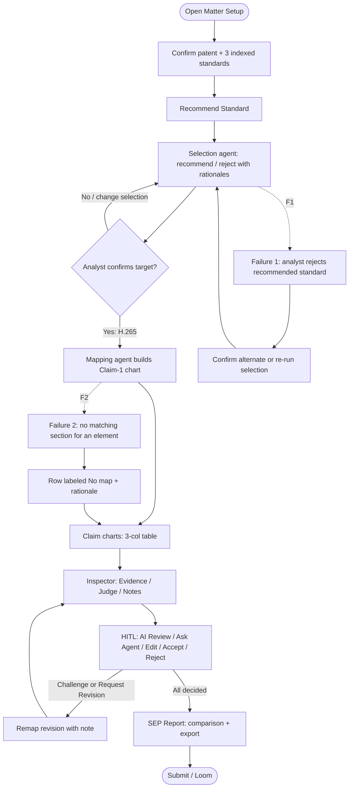

# User flow — LexNorm SEP chart builder (one page)

Happy path for a technical patent analyst on US10063856B2 → H.265 V10 Claim 1, plus two failure branches.

## Happy path (compressed)

1. **Setup** — patent US10063856B2; standards G.722.2 / H.265 V10 / TS 36.211 indexed; Recommend Standard  
2. **Target** — system recommends H.265, rejects audio + LTE with reasons; analyst confirms H.265 → Start Chart Preparation  
3. **Chart** — each Claim-1 element gets Source · Quote · Screenshot and Full / Partial / No + rationale  
4. **Inspector** — Evidence (PDF), Judge (review agent / AI Review), Notes (persisted threads)  
5. **HITL** — Apply fix / Ask Agent / Edit / Request Revision / Rerun; then **Accept / Reject** on every row  
6. **SEP Report** — standard comparison, unresolved deep links, draft Word anytime; final after all dispositions; optional ZIP bundle  
7. **Evaluation (internal)** — C01–C06 vs gold pack; no blended score; Conditional Go until expert sign-off  

## Failure branch 1 — Analyst rejects the recommended standard

**Trigger:** Analyst disagrees with H.265 (or wants to force a rejected standard for stress-test).  
**System:** Does not hardcode the winner; keeps recommend/reject rationales visible.  
**Analyst:** Unchecks H.265 / selects another standard and confirms — or restarts selection.  
**Outcome:** Chart builds only for confirmed target(s). Wrong-domain charts should trend No map / Partial with clear rejects in Setup history.  
**Guardrail:** Export still requires verifiable cites; no invented clauses to “make” a bad standard look essential.

## Failure branch 2 — No matching section for an element

**Trigger:** Retrieval finds no normative support (or only informative/tangential text).  
**System:** Emits **No map** (or Partial with explicit gaps) — absence is a valid, valuable outcome.  
**Analyst:** Can Challenge (“search again / wrong gap”) or Accept No map.  
**Outcome:** Row stays without fake quote/screenshot pressure; review agent does not require screenshot for pure No-map rows.  
**Guardrail:** Prefer under-mapping to false Full; evals score rationale honesty (C05) and label policy (C06).

## Checkpoints (HITL)

| After | Analyst can |
|---|---|
| Selection | Confirm / change standards |
| Chart + Judge | Evidence, Notes, Ask Agent, Edit, Request Revision, Rerun, Challenge, Accept, Reject |
| SEP Report | Jump unresolved rows; export draft / final / bundle |
