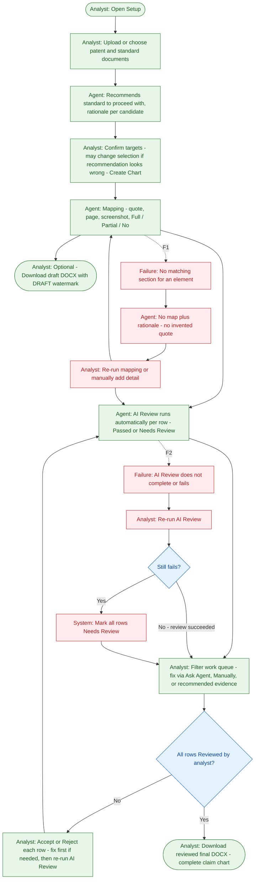

# Deliverable 2 — One-page user flow (LexNorm)

Happy path: load patent → export reviewed claim chart for **US10063856B2 Claim 1 → H.265 V10**.  
**Agent** = works alone. **Analyst** = reviews / intervenes.

**Legend:** green = happy path · red = failure / recovery · blue = decision  
Incomplete evidence or a failed check counts as **Needs Review** (not a separate Incomplete status).  
**Draft** Word is available anytime after mapping (**DRAFT** watermark). **Reviewed final** unlocks only when every row has an analyst disposition (Accept or Reject) — AI Review Passed alone does **not** unlock final.

## Happy path (agent vs analyst)

| Step | Who | What happens |
|---|---|---|
| 1. Setup | **Analyst** | Upload or choose patent; select candidate standard documents |
| 2. Recommend | **Agent** then **Analyst** | Agent recommends which standard(s) to proceed with, each with a rationale. Analyst confirms; if the recommendation looks wrong, they can select a different document and still start charting |
| 3. Mapping | **Agent** | Builds Claim-1 chart: verbatim quote, edition/section/page, screenshot, Full/Partial/No + gaps |
| 4. AI Review | **Agent** | Runs **automatically** after mapping. Outcome per row: **Passed** or **Needs Review** (missing evidence / failed checks count as Needs Review — no separate Incomplete status). AI Review guides the queue; it does **not** unlock the final chart |
| 5. Exception handling | **Analyst** | Filters the work queue. Fixes via **Ask Agent**, **Manually**, or **recommended evidence**; re-runs AI Review as needed; **Accept** or **Reject** each row |
| 6. Export | **Analyst** | **Draft** DOCX anytime after mapping — diagonal **DRAFT** watermark (working copy, not for delivery). **Reviewed final** (complete claim chart) **only when every row is Reviewed by the analyst** (Accept or Reject) |

## Setup note — changing the recommendation is normal

The selection agent can be wrong. Unchecking a Recommended standard (e.g. H.265) or opting into a Rejected candidate is **not a failure path** — it is expected analyst control. Chart only confirmed targets; track **recommendation accept / override rate** as an LLM stage metric (see PRD Success metrics).

## Failure branch 1 — No matching section found

**Trigger:** Retrieval finds no normative support for an element (or only tangential text).  
**Agent:** Emits **No map** (or Partial with explicit gaps) — absence is a valid outcome; no fake quote/screenshot pressure.  
**Analyst:** Re-runs mapping and/or **manually adds detail**, then continues into AI Review.  
**Guardrail:** Prefer under-mapping to false Full.  
**Export:** Draft with watermark remains available; reviewed final stays locked until every row is Accept/Reject.

## Failure branch 2 — AI Review fails

**Trigger:** AI Review does not complete or fails for the chart.  
**Analyst:** Re-runs AI Review.  
**If still fails:** System marks **all rows Needs Review**; analyst must clear them via Ask Agent, manual edit, or recommended evidence, then **Accept or Reject** each row.  
**Export gate:** Reviewed-final download unlocks only when **all rows are Reviewed by the analyst** (Accept or Reject). AI Review Passed alone is not enough.

## Intervention checkpoints

| After | Agent alone | Analyst intervenes |
|---|---|---|
| Selection | Recommend/reject rationales | Confirm or change targets (override is normal) |
| Mapping | Chart draft + evidence | On F1: re-run or manually add detail |
| AI Review | Runs automatically after mapping — Passed or Needs Review | On F2: re-run; if still fails, all rows Needs Review |
| Work queue | — | Ask Agent, Manually, or recommended evidence; Accept / Reject each row |
| Export | — | Draft anytime (watermarked). Reviewed final only when all rows are Reviewed by the analyst |
